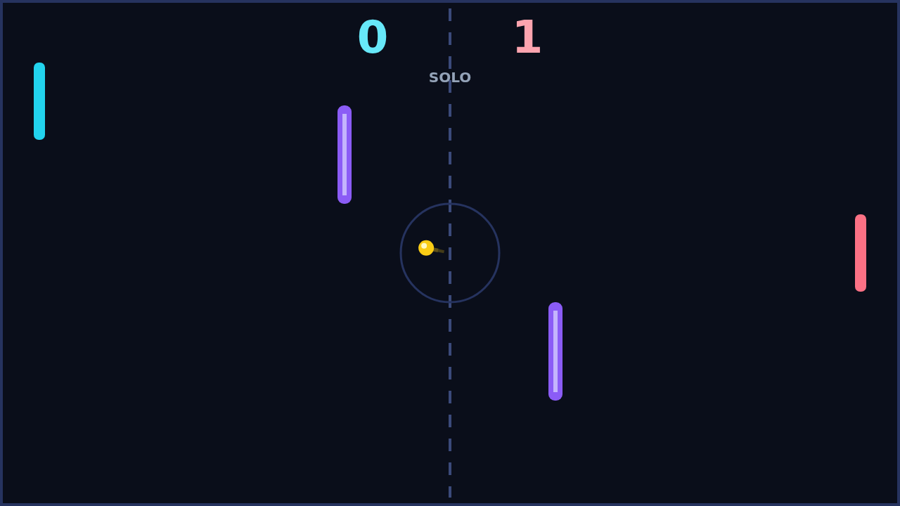
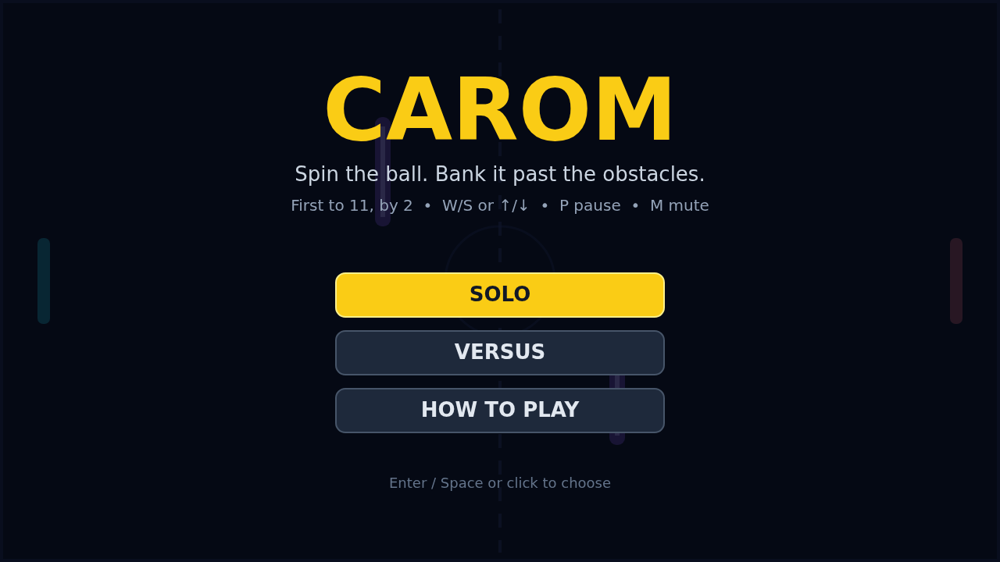

# Carom

Carom is a top-down paddle duel for two paddles, a fast ball, and a field interrupted by two purple obstacles. You guard your edge, chase the ball up and down your side, and try to send it past the far edge behind your opponent.

A match starts with a short countdown, then the serve breaks toward the player who must receive it. Rallies build speed with every paddle hit, the ball ricocheting off the top and bottom walls and caroming off the obstacles in the middle. Those obstacles turn a straight shot into a puzzle: the direct line is often blocked, so the winning shot banks around a bar or bends behind it.

Spin is how you create those impossible angles. Strike the ball while your paddle is moving and the ball curves in flight, arcing toward the direction of your stroke before the curve fades. A rising paddle bends the ball upward, a falling paddle bends it down, and a perfectly timed flick can curl a shot around an obstacle and away from a waiting opponent.

Play solo against an AI that tracks the incoming ball and retreats to center when the ball moves away, or share the keyboard in Versus. The first player to 11 points, leading by at least two, wins the match.

